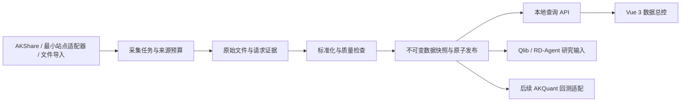

# 稳定日频采集与数据总控设计

日期：2026-11-02，用户时区 Asia/Shanghai。状态：依据用户最新要求确定的工程方向；本轮完成源码研究、分层探测和独立 A 股全市场原始日线采集验证，以下产品模块仍未全部实现。

## 1. 用户约束与本次决策

用户最新允许使用 AKShare，要求平衡取数难度，实时性要求不高，单次取数希望在 1 分钟以内，关键是稳定性；同时希望参考 AKQuant。此前“全部手搓、禁止现成产品 API”按这次明确的 AKShare 例外调整，不再理解为禁止所有外部接口。

- 数据采购预算为 0。允许 AKShare、开源基础库、公开原始文件和我们自己的站点适配器。
- 自建任务调度、按来源控制并发、缓存、错误处理、标准化、质量门槛、版本归档和本地查询；不从零重写 HTTP、Parquet、数据库或前端底座。
- 对限制过严、实际不可用的接口不建立主链路依赖；不再以 BaoStock 登录成功作为整个项目继续推进的前提。
- 自建服务可控制本地并发，上游站点的限制仍然存在。AKShare 调用和自行改写同一站点的 HTTP 调用共享同一来源预算。
- 本设计的接口选择约束用于金融数据获取层；RD-Agent 研究主体与已有独立测试隔离要求继续保留。
- 前端展示优先，沿用当前 Vue 3/SoybeanAdmin 工作台，数据源异常时仍展示最近一次已验证的真实快照及其日期。

“一分钟”在本设计中具体化为：**已有历史缓存时，对固定研究池完成一次日常增量批次的耗时目标**。首版以现有 30 只股票为验收范围，扩至 300 只后重新测量。不将首次全市场多年历史补库、财务全库和新闻采集混入此目标；不是要求每分钟反复采集日线。

## 2. 方案比较

| 路线 | 收益与代价 | 决策 |
| --- | --- | --- |
| 直接大量调用单个免费库 | 接入快，但库内部的附加请求、缺失处理、无超时调用会影响整条链路 | 不作为完整架构；只作为来源适配器 |
| 完全手写所有上游协议和解析 | 控制细，但维护页面/协议变化、复权口径和证券映射的成本高；不能消除上游限制 | 只在已定位的关键薄弱点采用，例如将基础日线与流通股本请求拆开 |
| 成熟库与源码参考 + 自建稳定层 + 本地版本快照 | 保留免费接口的便利，同时自主控制任务、依赖、质量与展示 | 采用；符合用户最新的取数难度与稳定性取舍 |

## 3. AKQuant 的实际位置

已读取其官方首页、数据指南和教材数据章节。数据指南的 A 股示例直接调用 `ak.stock_zh_a_hist`，同时支持本地 CSV、DataFrame 和 Parquet/DataFeed 输入。因此，AKQuant 可参考数据标准、文件化 ETL 和引擎输入适配；不是独立保证免费数据稳定性的供应方。

保留 Qlib 的数据格式和研究工具、RD-Agent 的研究编排；AKQuant 放在后续策略级回测适配位置，待交易时点、费用、T+1、停牌/涨跌停等语义验证后再决定实际采用。本轮没有安装或运行 AKQuant，不给出撮合性能或回测正确性验收结论。

教材示例中存在网络失败后生成随机行情的演示兜底。该行为不能进入本项目的真实研究或展示链路；本系统的降级只使用有来源和版本的历史真实快照。也不直接复制示例中的宽泛填充、去重或数据可得性假设。

官方文档证据：`docs/evidence/2026-11-02/akquant-docs.json`。

## 4. 当前实测与源码证据

AKShare 1.18.88 安装在独立验证环境，未加入产品 `.venv`。该版本是本轮实际测试版本，不宣称为所有环境的最新版本。GitHub 克隆因本机连接失败未成功；已将安装包中的四份相关源码及 MIT 许可证保存到工作区的 `research/open_source/source_snapshots/akshare-1.18.88/`，记录版本、来源及逐文件 SHA-256，没有伪造 Git 提交号。

| 项目 | 本机结果 | 对架构的影响 |
| --- | --- | --- |
| `stock_zh_a_hist` / 东方财富日线 | 初始本机路径下出现 TLS/读超时；VPN 路径变化后同参数恢复 HTTP 200；30 只分层样本原始与前复权请求 60/60 成功 | 作为可用候选继续独立限速验收；不因一次恢复宣称长期稳定，不扩大请求量 |
| `tool_trade_date_hist_sina` | 成功，8,797 个日期，1990-12-19 至 2026-12-31；HTTP 约 0.59 秒 | 可用日历样本；包含未来日历日期，不代表未来行情或所有日期均已完成交易 |
| `stock_zh_a_daily` / 新浪日线 | 原始 K 线 HTTP 200；后续流通股本请求 SSL 失败，库函数整体失败；独立原始适配已完成 5,576 只当前 A 股采集 | 基础行情与辅助股本应拆开；不因股本接口故障丢弃已取得原文 |
| 新浪原始日线离线解码 | 6,417 行，1999-11-10 至 2026-10-30；训练期 2015 年一季度样本 57 行，解码约 0.20 秒 | 支持构建最小行情适配器，但不是全市场、复权或可交易性验收 |
| 新浪 `qfq-factor` | 初始现场 HTTP 6 秒读超时；后续独立 30 只试点成功，共 228 条因子记录 | 复权依赖仍需全量和公司行为一致性验收；不能把 30 只试点扩写成全市场因子合格 |
| 现有 Parquet 的五次本地读取 | 19,190 行；首次约 0.218 秒，后续约 0.002 秒 | 支持页面与上游取数解耦；不是前端 API 或扩容后性能的证明 |

源代码还显示：新浪便捷日线函数包含合并股本后的前向填充和按数值去重，需避免直接沿用为论文标准化规则；腾讯历史函数在本轮版本中按年份请求，日期格式与循环边界需要单独测试。来源相同的不同域名不视为互相独立的供应方。

### 本轮独立全市场采集证据

当前证券名单为交易所代码集合与腾讯分页交叉核验后的 5,576 只 A 股，剔除 1 只 CDR；新浪原始日线采集全部成功，2015-01-01 至 2026-10-30 窗口共 11,393,279 行，首轮补库 2,894.643 秒。离线审计显示文件哈希失败 0、重复键 0，但有 36 只证券的价格质量异常、200 行异常价格、35 行零成交量和 231,002 个上市后交易日缺口；研究就绪仍为 false。北交所保留上市日前历史，当前不自动用于 A 股实验。详见 `docs/a-share-full-market-test-2026-11-02.md` 和 `docs/evidence/2026-11-02/a-share-full-market-test.json`。

证据为 `docs/evidence/2026-11-02/akshare-probe.json`、`local-data-read-benchmark.json` 和 `docs/evidence/2026-11-02/a-share-full-market-test.json`。全市场 probe 证明当前网络条件下原始日线批量链路可以完成，但仍不是产品并发压测、长期稳定性或研究快照验收，不能据此宣布长期稳定。

## 5. 数据流与模块边界

沿用已安装的 Python 3.10、pandas、pyarrow、httpx、FastAPI、SQLite 与前端 ECharts。首版无需 Redis、Celery、Kafka、MinIO、云服务或新增数据库。

现有 `thesis/store.py` 为研究任务设置了 `single_active_run` 唯一索引，`thesis/worker.py` 也持有研究执行锁。数据采集新增独立 `runtime/ingestion.sqlite3` 与采集 worker，不把研究 worker 改成并行执行器；可复用幂等、心跳、事件和原子写文件的组织方式。

数据目录：

- `runtime/ingestion/raw/<source>/<sha256>`：原文按内容存储，不混放不同来源。
- `runtime/datasets/<dataset_id>/`：标准化 Parquet、日历、证券表、复权/状态资产、质量报告和 manifest。
- `runtime/ingestion/current.json`：最近成功发布的快照引用，以临时文件加原子重命名更新。
- 历史实验继续引用原数据集。新增数据集不覆盖现有 `runtime/data`，也不悄悄替换旧实验输入。

## 6. 首版性能与失败处理

以下数字为工程目标，尚未实测通过：

| 指标 | 首版范围与验收定义 |
| --- | --- |
| 页面本地读路径 | 已存在快照时，本地数据摘要 API 的 P95 目标小于 1 秒；GET 不触发上游联网 |
| 日常增量批次 | 固定 30 只研究池、已有历史缓存；有效成功批次 P95 目标不超过 60 秒，独立统计成功率和完整性 |
| 单批截止 | 总计 60 秒；网络预算最多 45 秒，余下时间用于校验、发布和任务收尾；未完成项明确 deferred/partial |
| 并发初值 | 全局网络最多 4 个任务；同一实际供应方最多 1 个，最小发起间隔 0.5 秒。只在规则允许、连续样本通过后评估提高到 2 |
| 单任务阻塞 | 采集子进程硬上限 12 秒；支持参数的 HTTP 调用显式设超时。没有 timeout 参数的库函数也受进程截止约束 |
| 重试与熔断 | 可重试临时错误在剩余预算内最多重试 1 次；403 停止该来源，429 遵守 Retry-After；不通过更换同源域名或并发加倍来重试 |

网络抓取、离线解析、磁盘读取和前端查询分开限并发。多个站点可以受控并行，本地校验可以并行；这不等于同一上游可以无限并发。

快照和任务采用独立状态：旧快照可以 `ready`，同时最新任务为 `failed`。返回缓存不计为新鲜数据更新成功；部分批次不发布成完整研究快照。没有合格缓存时明确显示暂无数据。

来源替换以完整资产或明确版本进行，不将东财前复权价、新浪因子、腾讯成交量直接拼成同一个无差别价格序列。跨源差异单独出报告。

## 7. 首版数据范围与质量门槛

先稳定基础日线、不复权 OHLCV、金额、日历和复权口径；新闻、公告、财务、证券资料按其更新频率建立独立任务，辅助资产失败不阻塞基本行情展示。只有论文实验真正依赖的资产才进入研究快照的发布门槛。

原始层保留零成交量、停牌占位和未知状态。统一层将成交量转为股、金额转为元，保留供应方原始单位与转换依据；不得把源内空值统一变为 0，不按 OHLCV 数值删除不同日期的相同价格行。交易日期单独保存；采集时间统一 UTC，前端按 Asia/Shanghai 展示。

研究视图需验证唯一键、日历、证券日期范围、价格完整性、复权一致性、数据版本和可用字段。缺少历史成员、退市覆盖或披露修订时明确限制研究结论，不能因为换了采集工具便声称 PIT 完整。最终测试区间 2026-04-22 至 2026-10-30 继续保留，不在采集稳定性测试中计算其指标。

源选择采用能力状态，而非一个永远成功的名称：新浪最小日线适配已通过当前 A 股原始采集验证；东财日线通过 30 只分层采样，新浪因子通过 30 只独立试点，但两者仍未完成长期稳定性和全量研究资产验收；腾讯已有归档是真实缓存；BaoStock 为受串行规则约束的历史研究备选，不继续作为当前主线阻塞项。

## 8. Vue 3 展示与交互

复用现有配色、卡片、图标和 `ResearchChart`，在数据资产页增加独立组件，不再新建一套后台模板。

1. 顶部真实资产卡：数据截至日、采集成功时间、证券/记录数量、当前快照版本。采集时间与行情日期分开。
2. 来源健康卡：可用、降速、暂不可用；展示最近错误、样本数与耗时。样本不足时不展示虚构 P95。
3. 历史覆盖热力图和字段矩阵：通过真实覆盖统计生成，区分已上市但缺失、上市前、已退市和未知；不能一律补零。
4. 更新任务时间线：排队、抓取、解析、校验、发布；显示已完成/失败/延后数量与 60 秒预算。
5. 手动更新按钮：创建后台任务，立即返回任务 ID；原页面保持可读，刷新后可恢复进度。
6. 缓存降级状态：明确显示“显示最近可用快照，最近更新失败”，链接失败明细与最后成功日期。
7. 数据溯源抽屉：原始来源、接口/适配器版本、单位、原文指纹、标准化规则与关联实验。

前端只访问自建本地 API。计划接口为 `GET /api/data/sources`、`GET /api/data/summary`、`POST /api/data/jobs`、`GET /api/data/jobs/{id}`、`GET /api/data/coverage`；这些是本系统的查询/任务接口，不属于用户限制的第三方金融数据产品接口。

## 9. 风险分区与推进顺序

| 风险 | 当前结论与控制 |
| --- | --- |
| 较低：本地快照读与展示 | 已有真实缓存且读回很快；仍需本地 API、空状态和刷新恢复验收 |
| 中等：30 只日频取数在一分钟内 | 已有单证券和全市场原始采集证据；尚无产品 worker 的 30 只增量批次、尾延迟或长期成功率，仍需小池试点 |
| 中高：免费站点长期稳定与复权 | 东财分层 60/60、新浪因子 30/30 已恢复，但全量复权、公司行为和交易状态仍未验收；按能力隔离，保留旧快照 |
| 高：首次全市场多年历史、严格 PIT 财务 | 本轮 5,576 只首轮原始补库约 48 分 15 秒，不承诺一分钟；按真实覆盖、上市日前记录和质量异常约束论文结论 |

执行顺序：来源契约和可重放原文 → 独立采集任务/缓存 → 新浪最小行情适配与复权验收 → 本地摘要与 Vue 总控 → 固定 30 只增量验收 → 扩池与研究输入适配 → AKQuant 策略级回测评估。

## 10. 官方参考与本地证据

| 资料 | 地址或工作区路径 |
| --- | --- |
| AKShare 行情文档 | `https://akshare.akfamily.xyz/data/stock/stock_quote.html` |
| AKShare 交易日历 | `https://akshare.akfamily.xyz/data/tool/trade_date.html` |
| AKQuant 数据指南 | `https://akquant.akfamily.xyz/guide/data/` |
| AKQuant 数据教材 | `https://akquant.akfamily.xyz/textbook/03_data/` |
| AKShare 固定版本源码与许可 | `research/open_source/source_snapshots/akshare-1.18.88/UPSTREAM.json` 与 `LICENSE` |
| 本机采集、解码证据 | `rdagent_thesis/docs/evidence/2026-11-02/akshare-probe.json` |
| AKQuant 文档指纹 | `rdagent_thesis/docs/evidence/2026-11-02/akquant-docs.json` |
| 本地读取测量 | `rdagent_thesis/docs/evidence/2026-11-02/local-data-read-benchmark.json` |

本设计中的新模块和一分钟增量指标为后续实施目标，不能作为系统已具备能力引用；本轮独立 probe 的全市场原始采集结果也不能代替产品 worker 和快照发布验收。前序 BaoStock 调研和失败证据保留，但不再代表当前接入优先级。
